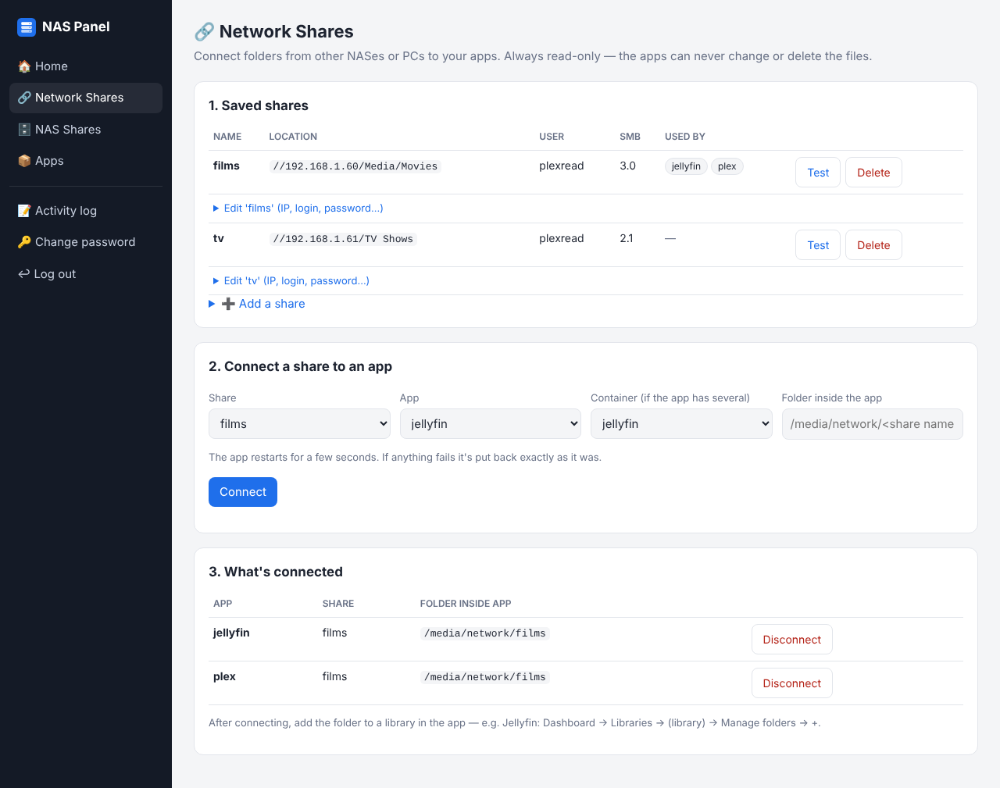

# NAS Control Panel

## 👉 [Install guide: click here](https://ibiddle.github.io/nas-panel/)

**New to all this?** The **[step-by-step install guide](https://ibiddle.github.io/nas-panel/)** walks you through every click, with pictures. No experience needed, nothing to type.

A small, password-protected web page for your NAS that connects shared folders from **other** NASes or PCs (SMB / Windows shares) to your Docker apps — Jellyfin, Plex, Emby, anything run with Docker Compose. No config files to edit, no command line after install.

- Tests the connection before saving anything
- Always mounts shares **read-only** - apps can never change or delete the files
- If connecting fails, the app is put back exactly as it was
- Change a share's password once and every app using it is reconnected
- Login lockout: 5 wrong passwords in 10 minutes locks the panel for 10 minutes
- Activity log of every change and login attempt

Works on UGREEN, Synology, QNAP, Unraid, TrueNAS SCALE or any Linux box with Docker (Intel/AMD or ARM).

> ⚠️ **Security:** the panel controls Docker, which means it has admin-level power over your NAS. Use a strong password and keep it on your home network. **Do not** expose port 8090 to the internet (no port-forward, no Cloudflare tunnel, no reverse proxy).

## Install

The image is published for **Intel/AMD (amd64)** and **ARM (arm64)**:

    ghcr.io/ibiddle/nas-panel:latest

Your NAS downloads it automatically when you start the compose file below. To build it yourself instead: clone this repo and run `docker build -t ghcr.io/ibiddle/nas-panel:latest .`

### Run it
1. Make a folder on the NAS for the panel, e.g. `/volume1/docker/nas-panel`, and put [`compose.yaml`](compose.yaml) in it.
2. Check the lines marked `<-- CHECK` in `compose.yaml` (on a UGREEN NAS the defaults usually work as they are):
   | Setting | What to put |
   |---|---|
   | `PUID` / `PGID` | Your NAS user's IDs. SSH in and run `id yourname`. UGREEN admin is usually `1000`/`10`; Synology `1026`/`100` |
   | `APPS_DIRS` | The folder your Docker Compose apps live in (each app in its own sub-folder). Mount it at the **same path** in `volumes` |
   | `TZ` | Your time zone, e.g. `Europe/London` |
3. Start it: in your NAS's Docker app create a **Project** from the compose file, or run `docker compose up -d` in that folder.
4. Get the one-time setup code: `docker logs nas-panel` (or the container's **Log** tab) - look for `NAS PANEL SETUP CODE`.
5. Open `http://<your-NAS-IP>:8090`, enter the code and choose a password.
6. Optional: add a desktop shortcut in your NAS's Docker app pointing to port 8090 (UGOS: Containers → ··· → Desktop shortcut).

## Using it
1. **Network Shares → Add a share**: IP of the other device, share name, optional sub-folder, username, password. Use a **read-only** account on the other device, and give that device a fixed IP on your router.
2. **Connect a share to an app**: pick the share and the app. It appears inside the app at `/media/network/<name>` (changeable).
3. In the app, add that folder to a library (Jellyfin: Dashboard → Libraries → Manage folders → +).

**NAS Shares** lists shares mounted on the NAS itself and has a tester. Mounting a share for the whole NAS is left to your NAS's own remote-mount tool (it needs root).

## Requirements & limits
- Apps must be started with **Docker Compose** from a folder inside `APPS_DIRS`. Containers created by hand or by a NAS app store aren't listed.
- The NAS kernel needs SMB/CIFS client support (nearly all NASes have it).
- Share passwords can't contain commas or `'` (a limitation of SMB mount options).
- Passwords for shares are stored on the NAS in `data/shares.json` and in each app's `.env`, readable only by the PUID user.

## How it works
For each connected share the panel writes `<app>/shares/<name>.yaml` (a compose override adding a read-only CIFS volume) and adds the login to `<app>/.env`, then runs `docker compose up -d` for that app. `COMPOSE_FILE` in `.env` is updated so a manual `docker compose up -d` keeps the share too.

## Forgotten password
    docker exec nas-panel rm /data/auth.json && docker restart nas-panel
    docker logs nas-panel | grep 'SETUP CODE'

## Adding your own pages
Each page is a file in `app/tools/` exposing a Flask Blueprint `bp` and a `TOOL` dict; list it in `TOOL_MODULES` in `app/app.py` and rebuild.

## Updating
**Automatic (default):** the `updater` service in `compose.yaml` checks for a new version every day at `UPDATE_TIME` (04:00 by default) and restarts the panel only if there is one. Your password and settings are kept. Its volume must include the folder holding `compose.yaml`, at the same path.

- Update now: `docker exec nas-panel-updater /updater.sh now`
- See what it did: `docker logs nas-panel-updater`
- Turn it off: delete the `updater:` section from `compose.yaml` and run `docker compose up -d --remove-orphans`
- Stay on one version: change both `image:` lines to e.g. `ghcr.io/ibiddle/nas-panel:1.1.0`

**Manual:** `docker compose pull && docker compose up -d`

## Licence
MIT
