# Install guide for complete beginners

This guide assumes you have **never** used Linux, Docker, GitHub or a command line. Every click is written down. You will **not** need to:

- type any commands
- download, install or open any files on your computer
- understand the settings file. You just copy and paste it.

Allow about **15 minutes**. The pictures are from a **UGREEN NAS**. If you have a different make, read [Other NAS brands](#other-nas-brands) first.

---

## Words you'll see (plain English)

| Word | What it means |
|---|---|
| **NAS** | Your network storage box (for example a UGREEN DXP2800). |
| **UGOS** | The screen you see when you log in to a UGREEN NAS in your web browser. It looks like a computer desktop. |
| **Docker** | An app on your NAS that runs other apps (like Jellyfin, Plex, or this panel) in their own sealed boxes, so they can't mess up the NAS. |
| **Container** | One app running inside Docker. This panel runs as a container. |
| **Project** | A small group of containers that are set up together from one **settings file**. |
| **Settings file** | A short page of text that tells Docker what to download and how to run it. On GitHub it's called **compose.yaml**. You never open it with a program; you copy the text from the website and paste it into Docker. |
| **GitHub** | The website where this app is published, like an app store page. |
| **IP address** | Your NAS's number on your home network, for example `192.168.1.50`. |
| **Port** | A number added to the end of an address after a colon, like `:8090`. It picks *which* app on the NAS you're talking to. |
| **Copy / Paste** | Copy = **Ctrl + C**, Paste = **Ctrl + V**. Hold the **Ctrl** key (bottom-left of the keyboard), tap the letter, then let go. On a Mac use the **Cmd** key instead of Ctrl. |

---

## Part 1 — Log in to your NAS and find its IP address

**1.1** Open your web browser (Chrome, Edge, Firefox or Safari) and log in to your NAS the way you normally do. You should see the UGOS desktop with icons down the left-hand side.

> Only ever used the **UGREEN app** on your PC or phone? The desktop inside the PC app is the same, so you can follow along in there.

**1.2** Write down your NAS's IP address. You'll need it later.
1. Double-click **Control Panel** on the UGOS desktop.
2. In the list on the left, click **Network**.
3. Click the **Network connection** tab at the top.
4. Next to **LAN1 (Connected)** you'll see something like `(192.168.1.50 / DHCP)`. The numbers before the `/` are your **IP address**. Write them down.
5. Close Control Panel with the **✕** in its top-right corner. Don't change anything here.

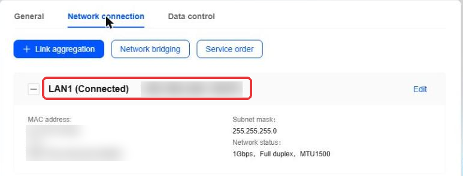
*(In the picture the IP address is blurred for privacy. Yours will show real numbers.)*

---

## Part 2 — Make sure Docker is installed

Look at the icons on your UGOS desktop.

- **If you can see a Docker icon** (a blue whale ②), Docker is installed. Skip to Part 3.
- **If you can't**, install it:
  1. Double-click **App Center** ①.
  2. Click in the **Search** box at the top-left ①, type `Docker` and press **Enter**.
  3. Click the **Install** button next to Docker ②. (In the picture it says *Open* because Docker is already installed.)
  4. Wait until it finishes, which takes a minute or two. If it asks which drive or "volume" to use, keep the one it suggests and click **Confirm**.
  5. Close App Center with the **✕**.

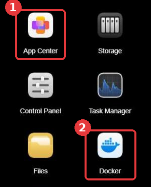

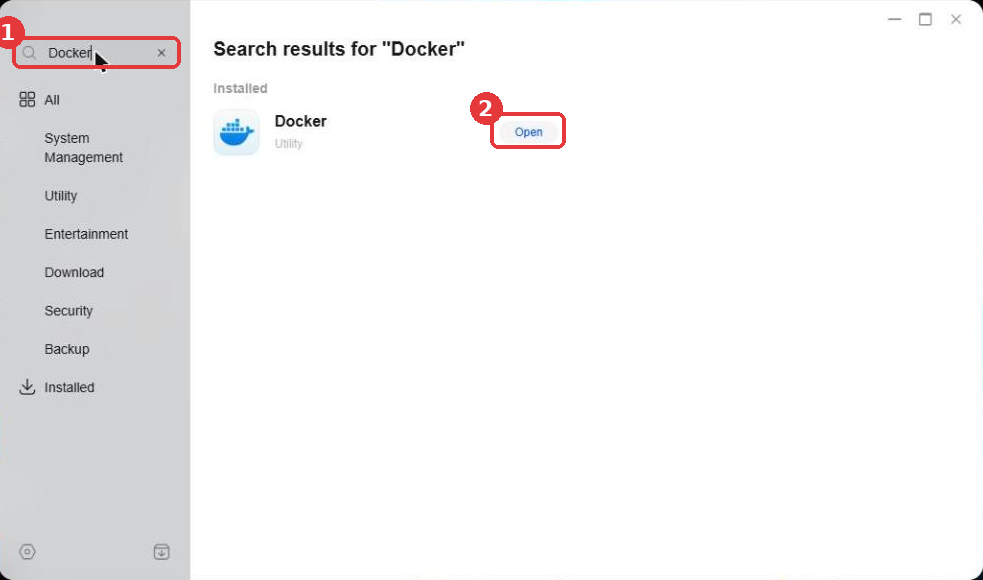

---

## Part 3 — Copy the settings from GitHub

You'll copy the settings from GitHub and paste them into Docker in Part 4.

**3.1** Open a **new tab** in your browser: press **Ctrl + T**, or click the **+** next to your open tabs.

**3.2** Click in the address bar at the very top of the browser, type `github.com/ibiddle/nas-panel` and press **Enter**.

**3.3** You'll see a list of files. Click the one called **compose.yaml** (circled in red). Don't click any others.

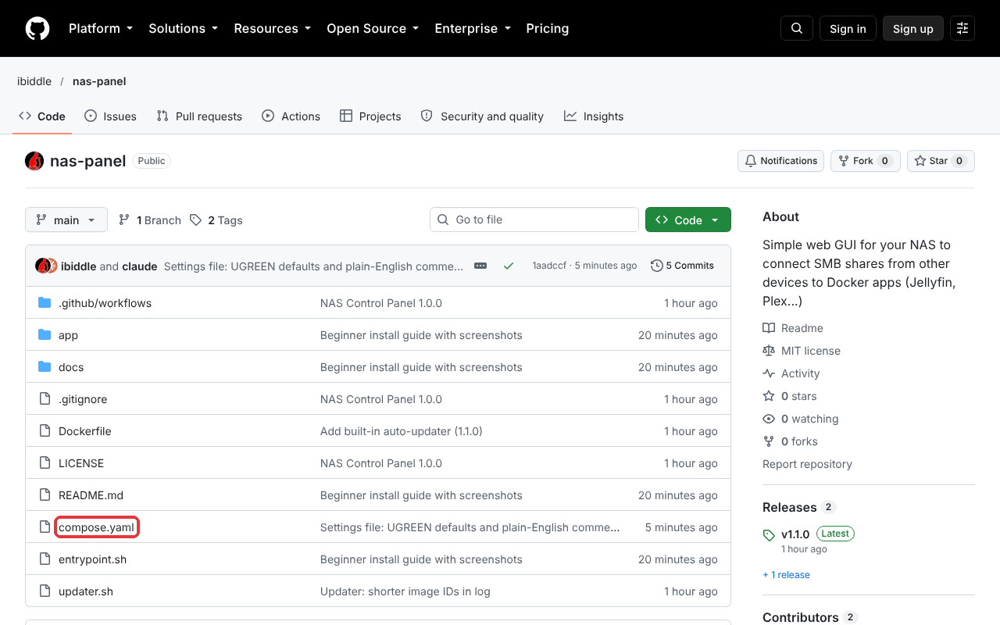

**3.4** The page now shows the settings text. Click the small **copy** button: two overlapping squares, above the text on the right (circled in red).

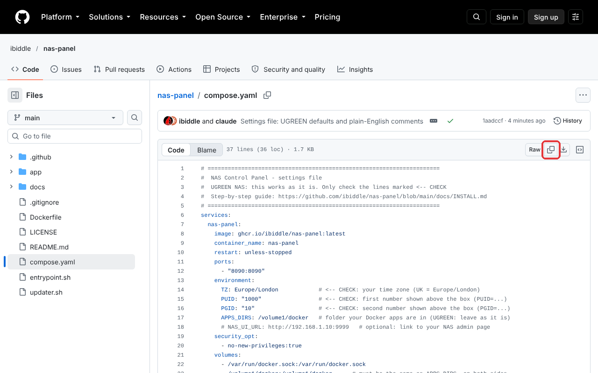

**Nothing visible happens. That's normal.** The text is now stored on your computer, ready to paste. You don't need a GitHub account, and you don't need to download or open anything.

> **Can't find the copy button?** Click **Raw** (just to its left). A plain page of text opens. Press **Ctrl + A** to select all of it, then **Ctrl + C** to copy it.

**3.5** Go back to your NAS's browser tab by clicking it at the top of the browser.

---

## Part 4 — Create the project in Docker

**4.1** On the UGOS desktop, double-click **Docker**. To make the window fill the screen, click the square **☐** button in its top-right corner.

**4.2** In Docker's left-hand menu, click **Project**, then click the blue **Create** button ①.

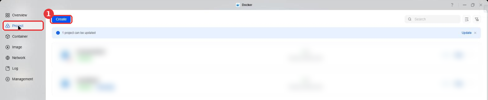

**4.3 Name.** Click in the **Name** box and type `nas-panel`.

**4.4 Storage path.** This is the folder where the panel keeps its settings.
1. Click the small **folder icon** at the right-hand end of the **Storage path** box. A *Folder selection* window opens.
2. Click the folder called **docker** ① so it's highlighted.
3. Click **Create folder** ②.

   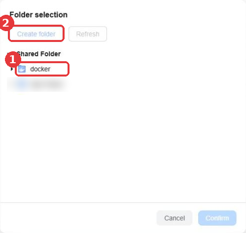

4. A box appears with the words *Create folder* in it. Delete those words (press **Backspace** until the box is empty), type `nas-panel`, then click **Confirm**.

   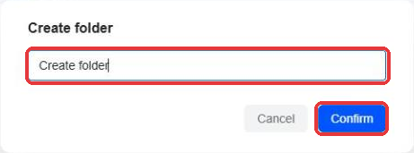

5. Back in *Folder selection*, click the small **▸** arrow next to **docker** to open it. Click the new **nas-panel** folder, then click **Confirm** at the bottom.

The **Storage path** box should now say something like `Shared folder/docker/nas-panel`.

**4.5 Paste the settings.** Click once anywhere inside the big empty box under **Compose configuration**. Then press **Ctrl + V**. About 40 lines of text appear.

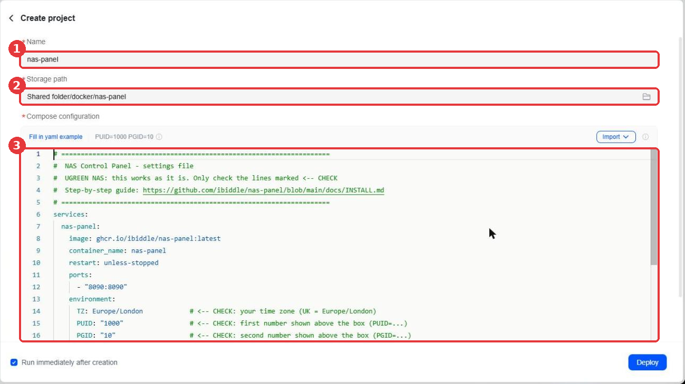

---

## Part 5 — Check three lines (usually nothing to change)

Look at the grey text just **above** the big box ①. It says something like **PUID=1000 PGID=10**. These are the ID numbers of your NAS login. Remember them.

Now look at lines 14, 15 and 16 in the box ②, the ones ending in **`<-- CHECK`**. You may need to scroll down a little with your mouse wheel while the pointer is over the box.

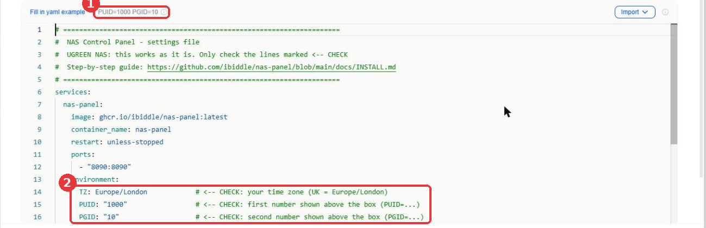

| Line | Leave it alone if… | Otherwise… |
|---|---|---|
| `TZ: Europe/London` | you're in the UK | change `Europe/London` to your area, e.g. `Europe/Paris`, `America/New_York`, `Australia/Sydney` ([full list](https://en.wikipedia.org/wiki/List_of_tz_database_time_zones), "TZ identifier" column) |
| `PUID: "1000"` | the grey text above the box says **PUID=1000** | change `1000` to the PUID number shown above the box |
| `PGID: "10"` | the grey text above the box says **PGID=10** | change `10` to the PGID number shown above the box |

There's a second `TZ` line near the bottom (in the *updater* section). If you changed the first one, change this one to match:

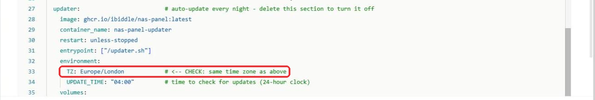

**How to change a value:** double-click the word or number to highlight it (for example double-click `1000`), then type the new one. Keep the quote marks `" "` where they are.

> **Don't change anything else, and don't add or remove spaces at the start of lines.** The spaces matter.

---

## Part 6 — Start it

At the bottom of the window, make sure **Run immediately after creation** is ticked ✔, then click **Deploy**.

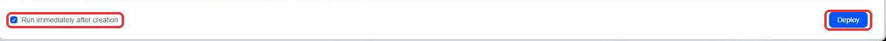

Your NAS now downloads the panel from the internet. **Wait 1–2 minutes.** When it's finished, click **Container** in Docker's left-hand menu. You'll see two new entries, both with a green **Running** label:

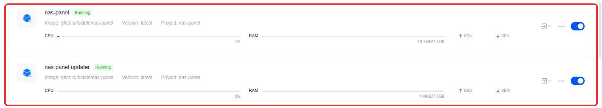

- **nas-panel** is the control panel itself.
- **nas-panel-updater** keeps the panel up to date by itself every night. You never need to touch it.

> **Got a red error instead?** The paste probably went wrong. Click **Project**, find **nas-panel**, click **···** → **Delete**, then start again from Part 4. Your NAS isn't harmed.

---

## Part 7 — Get your one-time setup code

The first time it starts, the panel creates a code to prove you're the owner.

1. In **Container**, click the **name** `nas-panel` (the words, not the switch).
2. At the top, click the **Log** tab ①.
3. Near the top of the black box, look for:

   ```
   ==================================================
     NAS PANEL SETUP CODE:  4F7A19C2
     Open http://<your-NAS-IP>:8090 and enter this code
   ==================================================
   ```

   Write down the 8 letters and numbers after `SETUP CODE:`. Yours will be different from the example.
4. Can't see it? Click the **Search** box ② at the top-right of the black box, type `SETUP` and press **Enter**.

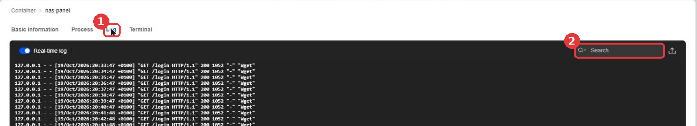

---

## Part 8 — Open the panel and choose your password

**8.1** Open a new browser tab (**Ctrl + T**).

**8.2** In the address bar, type `http://`, then **your NAS's IP address** from Part 1, then `:8090`. Press **Enter**.
For example, if your IP address is `192.168.1.50`, type: `http://192.168.1.50:8090`

**8.3** The *Set up NAS Panel* page opens:
1. **Setup code:** type the code from Part 7.
2. **New password:** choose a password of at least 8 characters, and write it down somewhere safe.
3. **Repeat password:** type the same password again.
4. Click **Create password**.

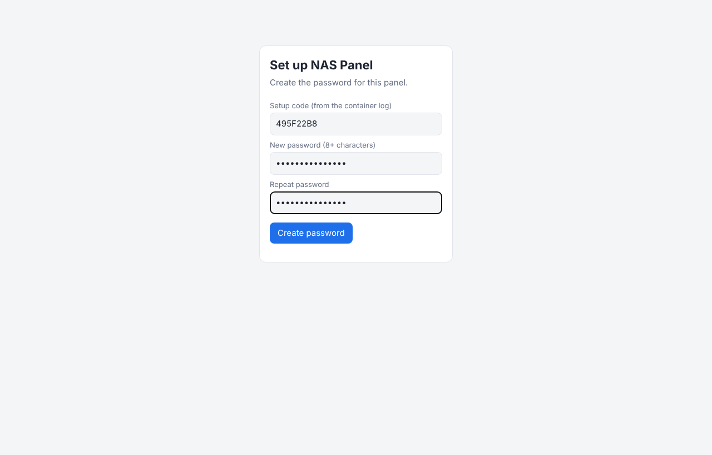

**8.4** You're in. This is the home page:

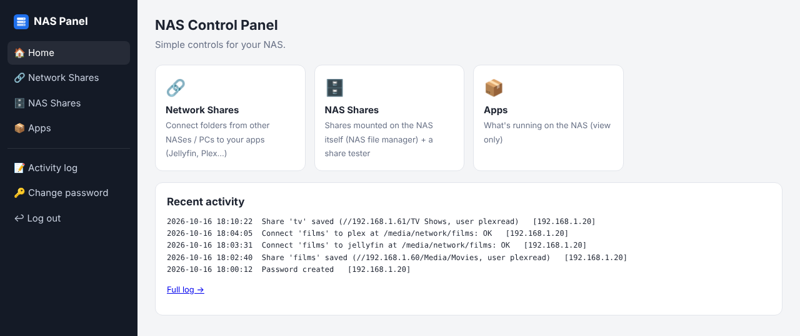

**Save it as a bookmark** so you can find it again: press **Ctrl + D**, then click **Done**.

**About the password:** if you type the wrong password 5 times within 10 minutes, the panel locks for 10 minutes. This stops anyone guessing it. If you forget it, see [I forgot my password](#i-forgot-my-password).

---

## Part 9 (optional) — Add an icon to your NAS desktop

1. Go back to **Docker → Container**.
2. On the **nas-panel** line, click the **···** button ①, then **Desktop shortcut** ②.

   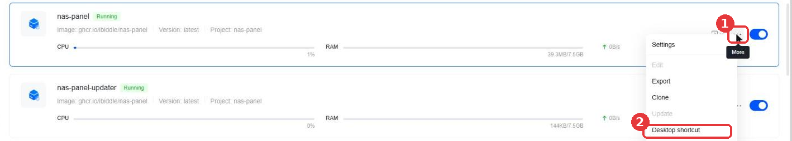

3. Everything is already filled in, including port **8090**. Click **Confirm**.

   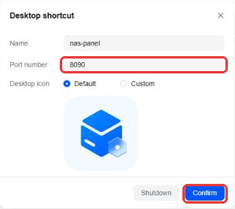

A **nas-panel** icon now appears on your UGOS desktop. Double-click it to open the panel.

---

## Using the panel: show films from another NAS or PC in Jellyfin / Plex

### First, on the other device (the one that has the films)

You need four things from it. Write them down:

| What | Example | Where to find it |
|---|---|---|
| Its **IP address** | `192.168.1.60` | On another UGREEN: Part 1 of this guide. On a Windows PC: Settings → Network & internet → your connection → *IPv4 address* |
| The **shared folder's name** | `Media` | The folder name you see when you open `\\192.168.1.60` in Windows File Explorer |
| A **username** | `jellyfin-read` | Ideally create a new user on that device that can only **read** the folder, not your main login |
| That user's **password** | | |

> **Tip:** if the other device's IP address ever changes, the connection stops working. Ask whoever manages your router to give it a "fixed IP" (it's called *DHCP reservation*).

### Then, in the panel

**Step 1 — Save the share**
1. Click **🔗 Network Shares** on the left.
2. Click **➕ Add a share**.
3. Fill in the boxes:
   - **Short name:** any short name in lower-case letters and numbers, e.g. `films`
   - **IP address of the other device:** e.g. `192.168.1.60`
   - **Share name:** e.g. `Media` (capital letters matter)
   - **Folder inside it:** only if the films are in a sub-folder, e.g. `Movies`. Otherwise leave it empty.
   - **Username** and **Password**
   - **SMB version:** leave it on `3.0`. Only change it if the panel tells you to.
4. Click **Test & save**. The panel tries to connect first, and only saves the share if it works. If something's wrong, it tells you what (for example *"Wrong username/password"*).

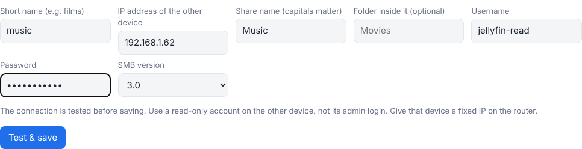

**Step 2 — Connect it to an app**
1. Under **2. Connect a share to an app**, choose your share in the **Share** list.
2. Choose **jellyfin** (or **plex**, etc.) in the **App** list.
3. Leave the other two boxes as they are.
4. Click **Connect**. The app restarts for a few seconds. If anything goes wrong, the app is put back exactly as it was.

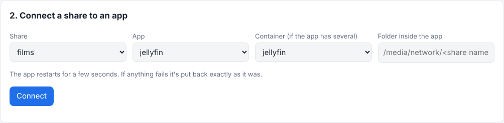

The share now appears under **3. What's connected**, with its folder name, for example `/media/network/films`:


**Step 3 — Tell Jellyfin (or Plex) about the folder**
- **Jellyfin:** open Jellyfin → click your profile picture (top-right) → **Dashboard** → **Libraries** → click your **Movies** library → in **Folders**, click **+** → type `/media/network/films` (use your own short name) → **OK** → **Save**. Jellyfin then finds the films. This can take a while for a big collection.
- **Plex:** open Plex → **Settings** (spanner icon) → **Manage → Libraries** → **Edit** next to your library → **Add folders** → **Browse for media folder** → choose `media` → `network` → `films` → **Add** → **Save changes**.

The connection is **read-only**: Jellyfin and Plex can play the films but can never change or delete them.

---

## Updates

You don't need to do anything. Every night at 4 am, **nas-panel-updater** checks for a new version and installs it if there is one. Your password and settings are kept.

---

## I forgot my password

No typing needed. Your saved shares and connections are kept.

1. Double-click **Files** on the UGOS desktop. Open **docker** → **nas-panel** → **data**.
2. Right-click the file called **auth.json** → **Delete**. Only that one file.
3. Open **Docker → Container**. On the **nas-panel** line, click **···** → **Restart**.
4. Repeat Part 7 to get a new setup code, then Part 8 to choose a new password.

---

## Something not working?

| What you see | What to do |
|---|---|
| A red error when you click **Deploy** | The paste went wrong. Start Part 4 again and paste with **Ctrl + V** only once. Don't type anything in the big box apart from the changes in Part 5. |
| The browser says **"This site can't be reached"** | Check the address: it must start `http://` (not https), use your NAS's IP address, and end in `:8090`. Check **nas-panel** shows **Running** in Docker → Container. |
| The panel says **"No Docker Compose apps found"** | Your other apps (Jellyfin etc.) must have been created through **Docker → Project**. Apps installed from App Center aren't listed. |
| A share won't save | Read the red message. It says what's wrong (wrong password, wrong share name, can't reach the device…). |
| "Locked - try again in … minutes" | Someone (probably you) typed the wrong password 5 times. Wait 10 minutes. |

Still stuck? Go to **github.com/ibiddle/nas-panel/issues**, click **New issue** and describe what happened. (You'll need a free GitHub account for this.) Never post passwords.

---

## Other NAS brands

This guide is written for **UGREEN**. Other makes work the same way, but the buttons have different names, and the settings file needs one extra change: the user ID numbers.

| NAS | Where "Project → Create" is | User ID numbers (PUID / PGID) | Apps folder |
|---|---|---|---|
| **Synology** (DSM 7.2+) | **Container Manager** → **Project** → **Create** → *Create docker-compose.yml* | Often `1026` / `100` | Change both `/volume1/docker` to the folder you use, e.g. `/volume1/docker` |
| **QNAP** | **Container Station** → **Applications** → **Create** | Often `1000` / `100` | e.g. `/share/Container` |
| **Unraid** | Install the **Docker Compose Manager** plugin → **Add new stack** | `99` / `100` | `/mnt/user/appdata` |

If the numbers are wrong for your NAS, the panel shows an error when it tries to save. Ask in the [issues](https://github.com/ibiddle/nas-panel/issues) and include your NAS make and model.
